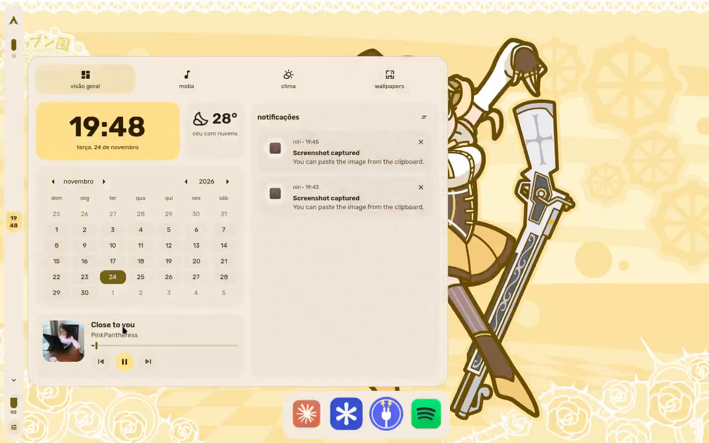

# octopus

[](https://github.com/pxotitas/octopus)
[](https://github.com/pxotitas/octopus/blob/main/LICENSE)
[](https://github.com/pxotitas/octopus)
[](https://github.com/pxotitas/octopus/stargazers)

a cozy m3 shell for niri. / um shell m3 cozy pro niri.

this branch is the shell itself: the companion, the scripts, the waybar and
the niri config. the docs live in branches of their own.

essa branch é o shell em si: o companion, os scripts, a waybar e o config do
niri. as docs moram em branches próprias.

<a href="https://github.com/pxotitas/octopus/blob/eng/screenshots/showcase.mp4">
  
</a>

<sub>click to watch / clica pra ver. more screenshots in / mais screenshots na
[`eng`](https://github.com/pxotitas/octopus/tree/eng#screenshots) and / e
[`pt-br`](https://github.com/pxotitas/octopus/tree/pt-br#screenshots).</sub>

| branch | what / o quê |
|---|---|
| [`main`](https://github.com/pxotitas/octopus/tree/main) | the code / o código |
| [`eng`](https://github.com/pxotitas/octopus/tree/eng) | readme and docs in english |
| [`pt-br`](https://github.com/pxotitas/octopus/tree/pt-br) | readme e docs em português |
| [`website`](https://github.com/pxotitas/octopus/tree/website) | the project's site / o site do projeto |

## install / instalar

```sh
git clone https://github.com/pxotitas/octopus ~/.config/octopus
~/.config/octopus/install.sh
```

then / depois, at the end of / no fim do `~/.config/niri/config.kdl`:

```kdl
include "~/.config/octopus/niri.kdl"
```

## license / licença

gpl-3.0-or-later. some parts come from [impasto](https://github.com/andreumassanet/impasto)
and [velatura](https://github.com/pxdritz1/velatura); see [`notice.md`](NOTICE.md).
