<p align="center">
  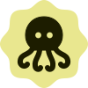
</p>

<h1 align="center">octopus</h1>

<p align="center">
  <a href="https://pxotitas.github.io/octopus/pt/">site</a> ·
  <a href="https://pxotitas.github.io/octopus/pt/docs/">docs</a> ·
  <a href="https://pxotitas.github.io/octopus/pt/media/">screenshots e vídeos</a> ·
  <a href="https://pxotitas.github.io/octopus/pt/changelog/">changelog</a>
</p>

<p align="center">
  <a href="https://github.com/pxotitas/octopus"></a>
  <a href="https://github.com/pxotitas/octopus/blob/main/LICENSE"></a>
  <a href="https://github.com/pxotitas/octopus"></a>
  <a href="https://github.com/pxotitas/octopus/stargazers"></a>
</p>

shell m3 cozy pro niri: uma barra vertical minimalista na waybar, com tudo
que é maior (central de controle, dash, menus, notificações) num companion
em rust + gtk4.

superfícies opacas e tonais, sem blur (só a tela de bloqueio desfoca).
português ou inglês. as cores saem do wallpaper via matugen.

> essa é a branch das docs em português. o código fica na
> [`main`](https://github.com/pxotitas/octopus/tree/main); em inglês, na
> [`eng`](https://github.com/pxotitas/octopus/tree/eng).

## showcase

o vídeo inteiro, com som, tá no [site](https://pxotitas.github.io/octopus/pt/media/). aqui ele tá cortado em clipes curtos; clica num pra abrir.

<details>
<summary><b>dash</b>: visão geral, música e a letra sincronizada</summary>
<br>


</details>

<details>
<summary><b>clima e wallpapers</b>: a previsão, depois o seletor de wallpaper</summary>
<br>


</details>

<details>
<summary><b>central de controle</b>: atalhos, sliders e o player</summary>
<br>


</details>

<details>
<summary><b>tela de bloqueio</b>: shapes que mudam a cada tecla, com a letra sendo cantada</summary>
<br>


</details>

<details>
<summary><b>launchers</b>: o rofi e o spotlight</summary>
<br>


</details>

<details>
<summary><b>emoji</b>: o seletor, com busca</summary>
<br>


</details>

<details>
<summary><b>configurações</b>: cores, idioma, barra, widgets e dock</summary>
<br>

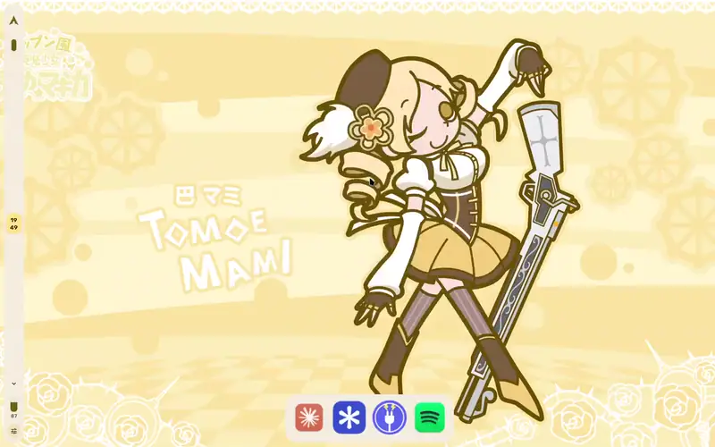

</details>

<details>
<summary><b>conta no spotlight</b>: digitando uma soma com <code>=</code></summary>
<br>

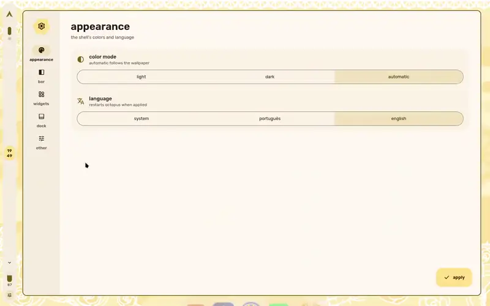

</details>

<details>
<summary><b>paleta do wallpaper</b>: um wallpaper novo repinta o shell inteiro</summary>
<br>


</details>

## screenshots

estão todas em [`screenshots/`](screenshots). clica num grupo pra abrir.

<details>
<summary><b>desktop</b>: a barra, os widgets de desktop, notificações e o osd</summary>
<br>

a barra vertical na esquerda, e os widgets de desktop na direita: o clima e as contribuições no github, que dá pra mover e redimensionar.


uma notificação, com o ícone do app.


o osd, pra volume e brilho.


</details>

<details>
<summary><b>central de controle</b>: atalhos, sliders, player e notificações</summary>
<br>


</details>

<details>
<summary><b>dash</b>: rail, relógios, calendário, player, notificações, clima e wallpapers</summary>
<br>

a visão geral, que abre pelo relógio da barra: rail de navegação, um relógio analógico num cookie, e as notificações em cima de um card de clima pequeno.

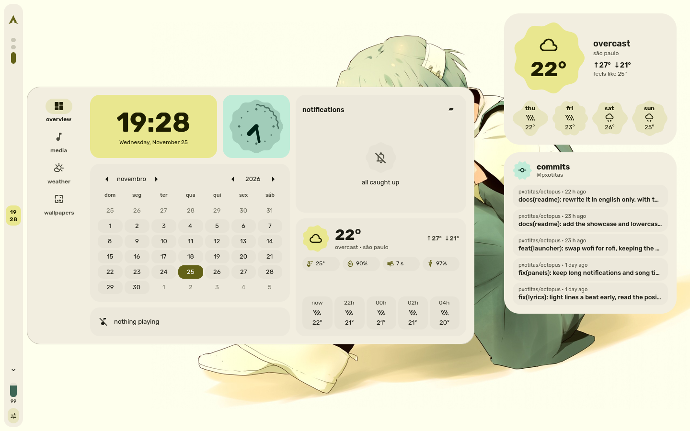

a aba de wallpapers; escolher um também gera a paleta.


</details>

<details>
<summary><b>clima</b>: shapes m3, e perguntas depois de um <code>&gt;</code></summary>
<br>

agora: métricas em shapes m3, o arco do sol e a lua, as próximas 24 horas e os dias.


<code>&gt; amanhã</code>: um dia, e como ele fica comparado com hoje.

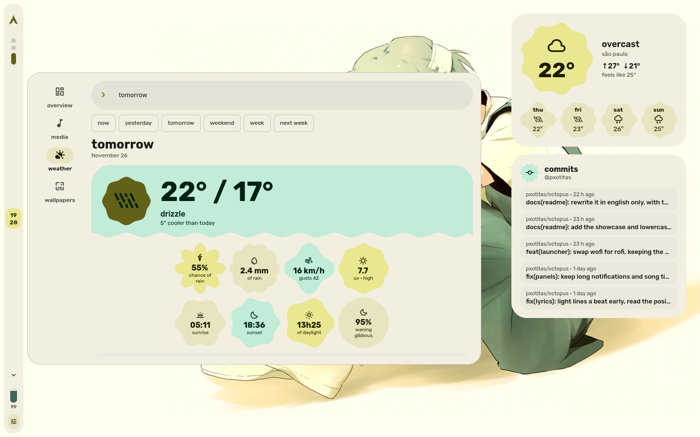

<code>&gt; ontem</code>: tem uma semana pra trás também.

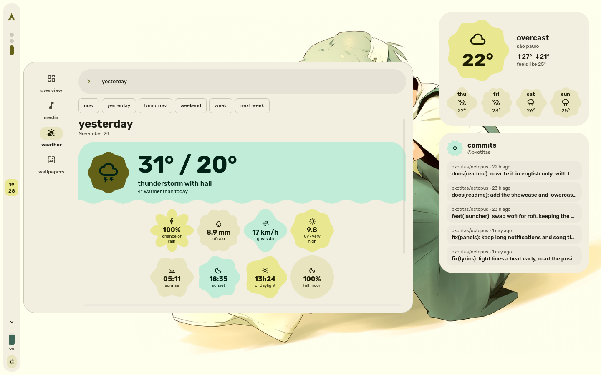

<code>&gt; semana</code> e <code>&gt; fim de semana</code>: os dias em shapes, com o mais quente, o mais fresco e o mais chuvoso.

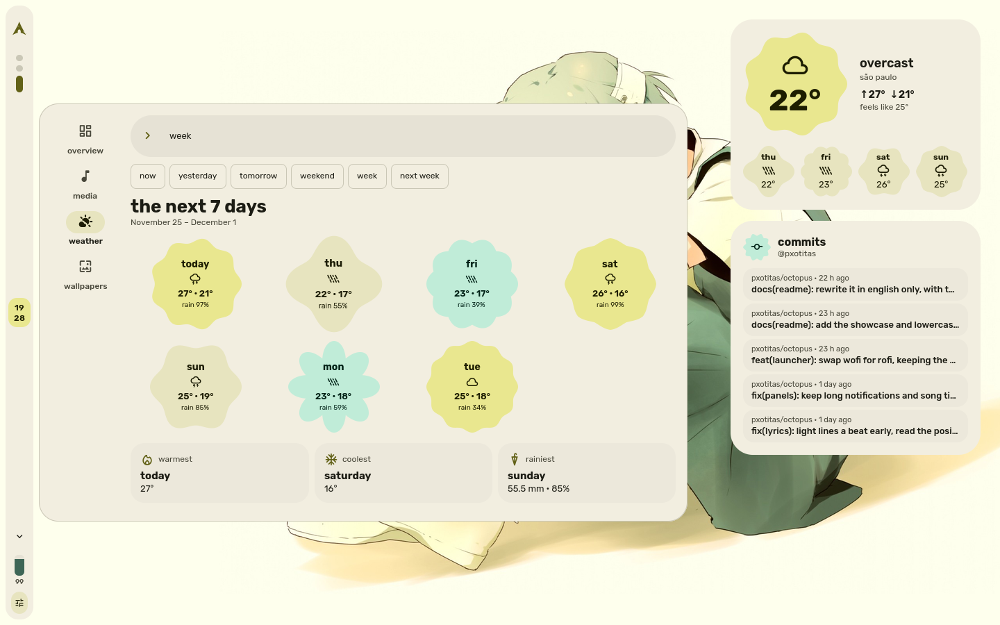

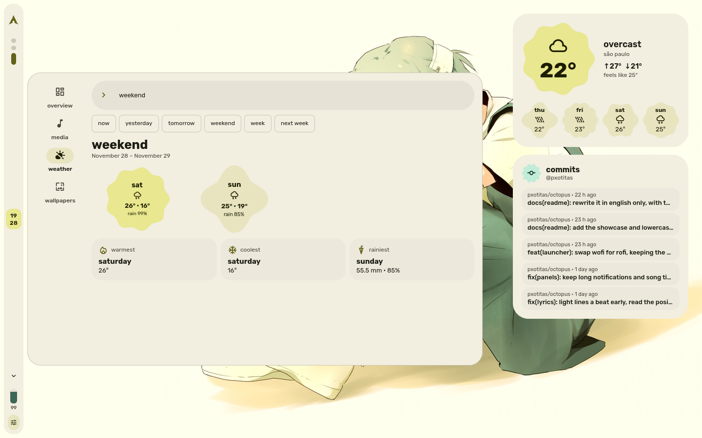

</details>

<details>
<summary><b>menus</b>: wi-fi, bluetooth, som, bandeja e energia</summary>
<br>

wi-fi


bluetooth

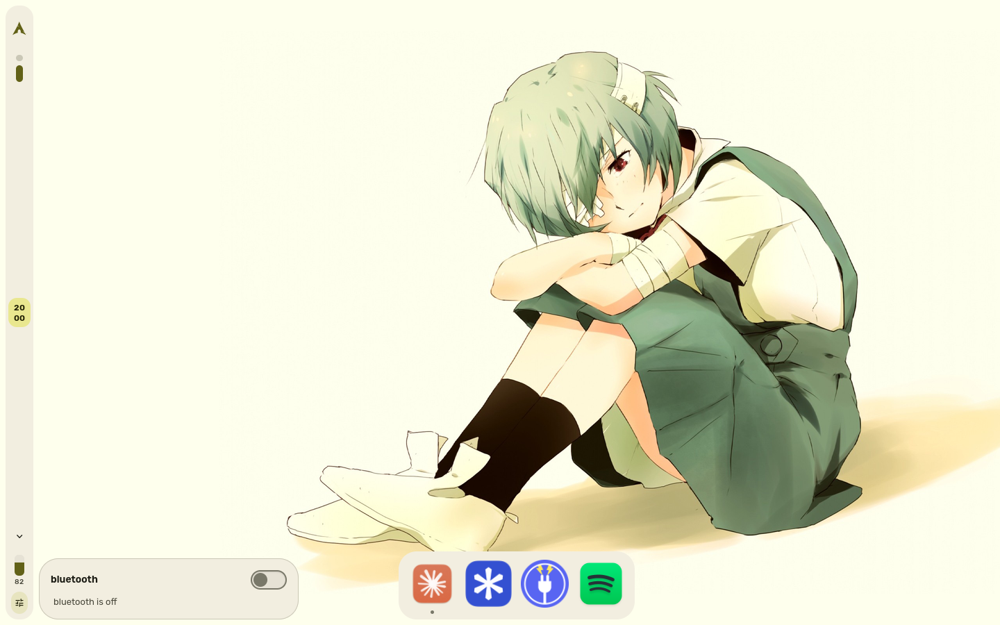

som, com saída, microfone e dispositivos


bandeja

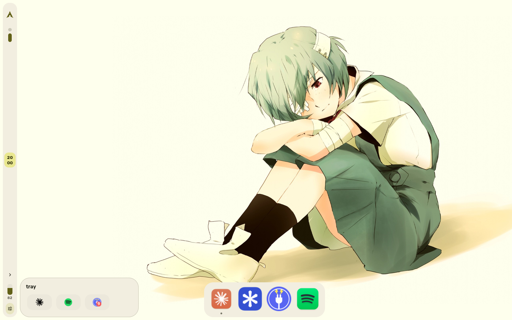

energia

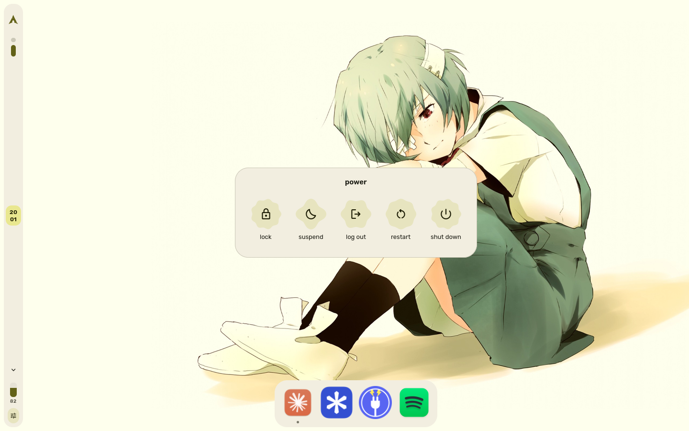

</details>

<details>
<summary><b>launchers</b>: o spotlight e o rofi</summary>
<br>

o spotlight (mod+space): apps, `=` pra conta, `/` pra arquivos e `>` pra energia.


o rofi (mod+d), com os apps ordenados pelo uso.


</details>

<details>
<summary><b>ferramentas</b>: clipboard e emoji</summary>
<br>

clipboard (mod+shift+v)


emoji (mod+.)

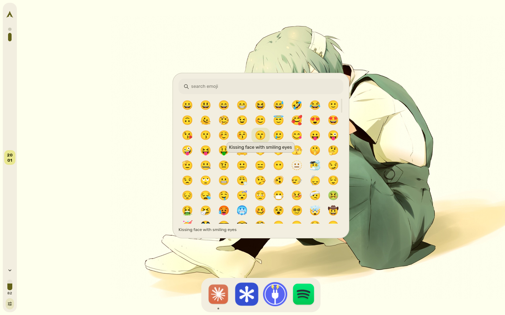

</details>

<details>
<summary><b>configurações</b>: cores, idioma, barra, widgets e dock</summary>
<br>

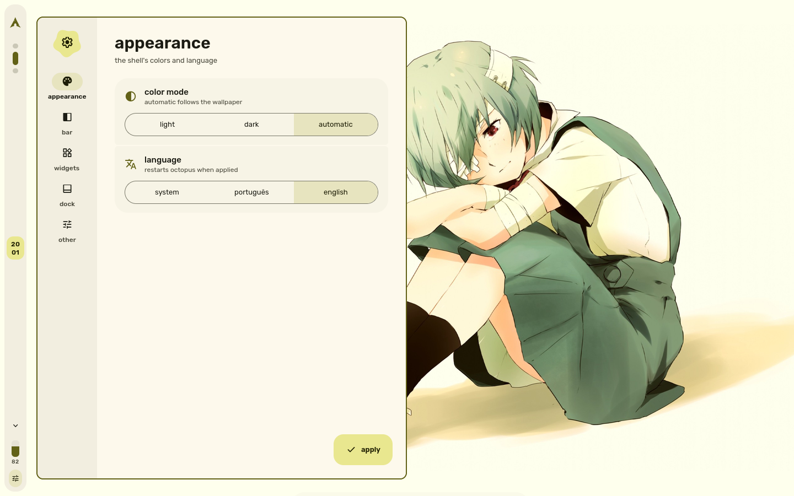

</details>

> as screenshots estão com o shell em inglês.

## peças

| parte | o quê |
|---|---|
| `waybar/` | barra vertical: logo, workspaces, relógio, bandeja (com a setinha animada do `tray-arrow.c`), bateria em pílula com o percentual e o grupo com drawer |
| `companion/` | `octopus`, o daemon: central de controle, dash (com seletor de wallpaper), spotlight, menus (wi-fi, bluetooth, som, bandeja, clipboard, emoji, energia), dock, configurações, notificações, osd e a tela de bloqueio |
| `scripts/` | tema, bateria, clima, letras, emoji, rofi e matuwall |
| `matugen/` | templates de cor pro companion, waybar, fuzzel, rofi e matuwall |
| `niri.kdl` | autostart, atalhos e layer rules, incluído no config do niri |

mais detalhes em [`docs/`](docs/README.md).

## instalar

depende de: `pam waybar matugen matuwall awww cliphist wl-clipboard wtype
playerctl cava brightnessctl networkmanager bluez-utils libpulse python python-dateutil
unicode-emoji unicode-cldr fd gcc rofi gtk3 gtk4 gtk4-layer-shell
ttf-material-symbols-variable rust`.

o repo mora no próprio `~/.config/octopus`:

```sh
git clone https://github.com/pxotitas/octopus ~/.config/octopus
~/.config/octopus/install.sh
```

o build fica em `~/.cache/octopus/target`.

depois, no fim do `~/.config/niri/config.kdl`:

```kdl
include "~/.config/octopus/niri.kdl"
```

## comandos

```
octopus                      # o daemon
octopus toggle <control-center|dash|wifi|bluetooth|audio|tray|clipboard|emoji|power|launcher>
octopus open wallpapers      # dash na aba de wallpapers
octopus settings
octopus close
octopus lock
octopus volume <up|down|mute>
octopus mic mute
octopus brightness <up|down>
octopus kbd <up|down>
octopus dnd
octopus reload               # regera o config da waybar
octopus restart
octopus luma <imagem>        # dark ou light, usado pelo modo automático
```

## configuração

`octopus.toml` (ou `octopus settings`): idioma, barra, dock, clima,
notificações e letras. pra sobrescrever estilos sem mexer no css embutido,
crie um `~/.config/octopus/style.css`; ele recarrega sozinho.

## licença

gpl-3.0-or-later. umas partes vêm do [impasto](https://github.com/andreumassanet/impasto)
e do [velatura](https://github.com/pxdritz1/velatura); ver o
[`notice.md`](https://github.com/pxotitas/octopus/blob/main/NOTICE.md) na main.
