<p align="center">
  
</p>

<h1 align="center">octopus</h1>

<p align="center">
  <a href="https://pxotitas.github.io/octopus/">site</a> ·
  <a href="https://pxotitas.github.io/octopus/docs/">docs</a> ·
  <a href="https://pxotitas.github.io/octopus/media/">screenshots and videos</a> ·
  <a href="https://pxotitas.github.io/octopus/changelog/">changelog</a>
</p>

<p align="center">
  <a href="https://github.com/pxotitas/octopus"></a>
  <a href="https://github.com/pxotitas/octopus/blob/main/LICENSE"></a>
  <a href="https://github.com/pxotitas/octopus"></a>
  <a href="https://github.com/pxotitas/octopus/stargazers"></a>
</p>

a cozy m3 shell for niri: a minimal vertical bar on waybar, with everything
bigger (control center, dash, menus, notifications) in a companion written
in rust + gtk4.

opaque, tonal surfaces, no blur (only the lock screen blurs). portuguese or
english. the colors come from the wallpaper through matugen.

> this is the branch for the docs in english. the code lives on
> [`main`](https://github.com/pxotitas/octopus/tree/main); in portuguese, on
> [`pt-br`](https://github.com/pxotitas/octopus/tree/pt-br).

## showcase

the full video, with sound, is on the [site](https://pxotitas.github.io/octopus/media/). here it's cut into short clips; click one to open it.

<details>
<summary><b>dash</b>: overview, music and the synced lyrics</summary>
<br>


</details>

<details>
<summary><b>weather and wallpapers</b>: the forecast, then the wallpaper picker</summary>
<br>

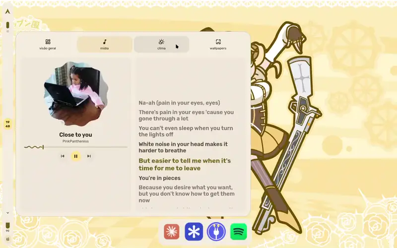

</details>

<details>
<summary><b>control center</b>: quick toggles, sliders and the player</summary>
<br>

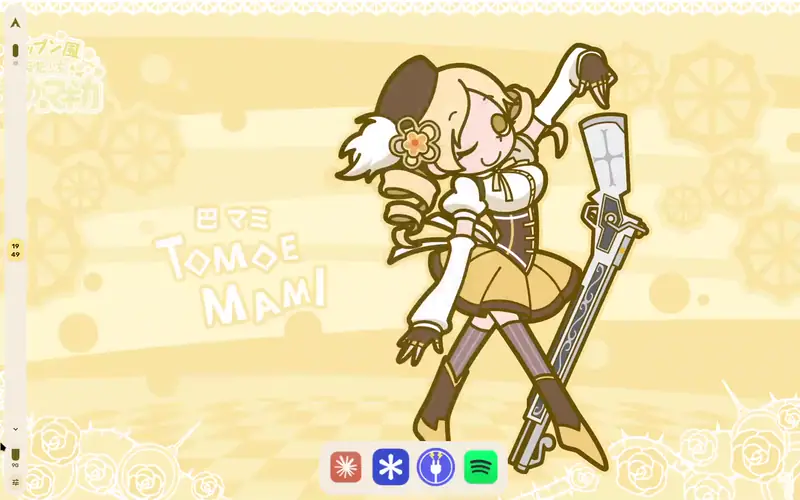

</details>

<details>
<summary><b>lock screen</b>: shapes that change at every key, with the lyric being sung</summary>
<br>


</details>

<details>
<summary><b>launchers</b>: rofi and the spotlight</summary>
<br>


</details>

<details>
<summary><b>emoji</b>: the picker, with search</summary>
<br>

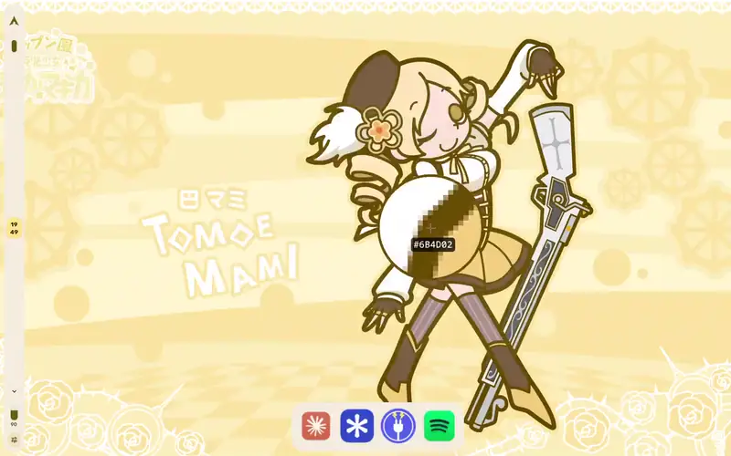

</details>

<details>
<summary><b>settings</b>: colors, language, bar, widgets and dock</summary>
<br>


</details>

<details>
<summary><b>spotlight math</b>: typing a sum with <code>=</code></summary>
<br>


</details>

<details>
<summary><b>palette from the wallpaper</b>: a new wallpaper repaints the whole shell</summary>
<br>

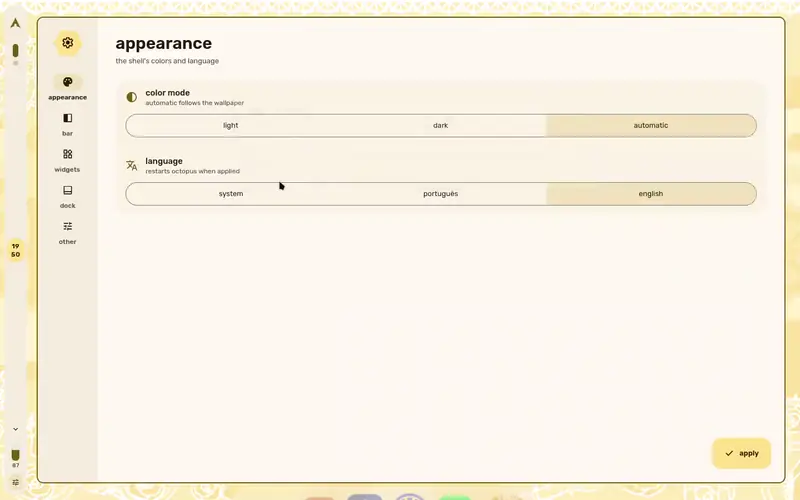

</details>

## screenshots

all of them are in [`screenshots/`](screenshots). click a group to open it.

<details>
<summary><b>desktop</b>: the bar, the desktop widgets, notifications and the osd</summary>
<br>

the vertical bar on the left, and the desktop widgets on the right: the weather and the github contributions, movable and resizable.

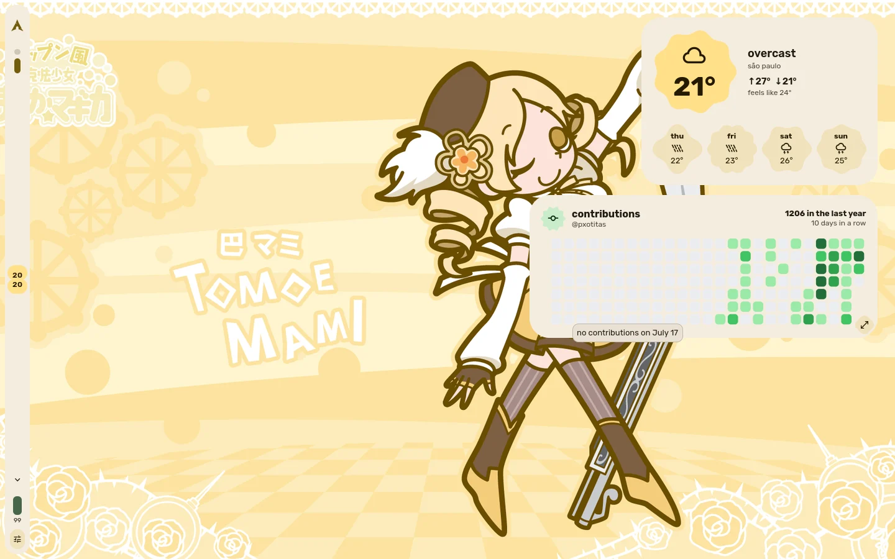

a notification, with the app's icon.

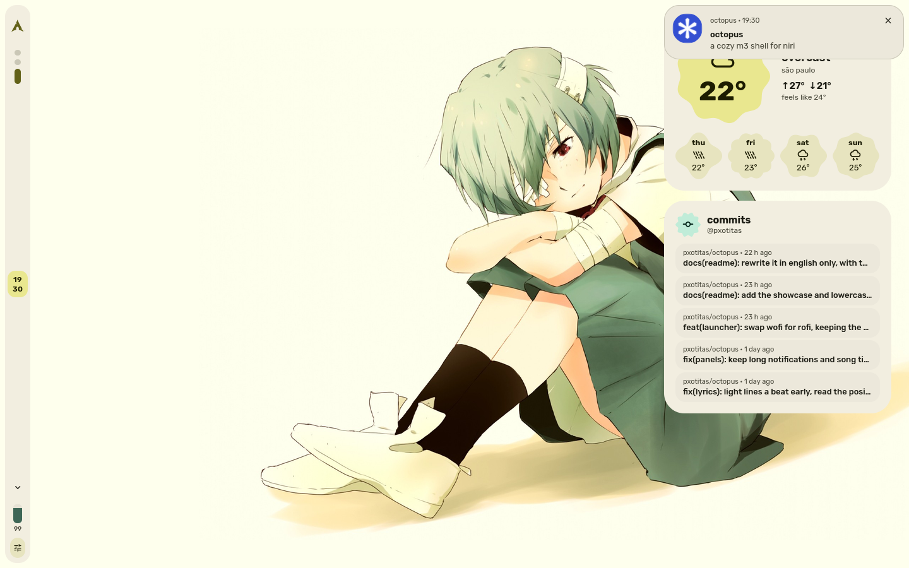

the osd, for volume and brightness.

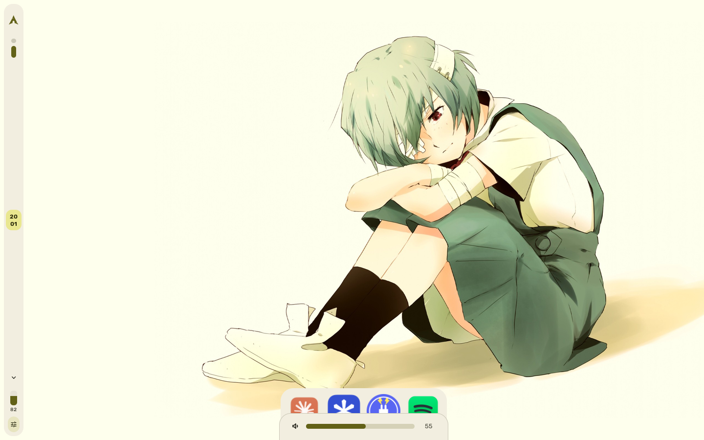

</details>

<details>
<summary><b>control center</b>: quick toggles, sliders, player and notifications</summary>
<br>

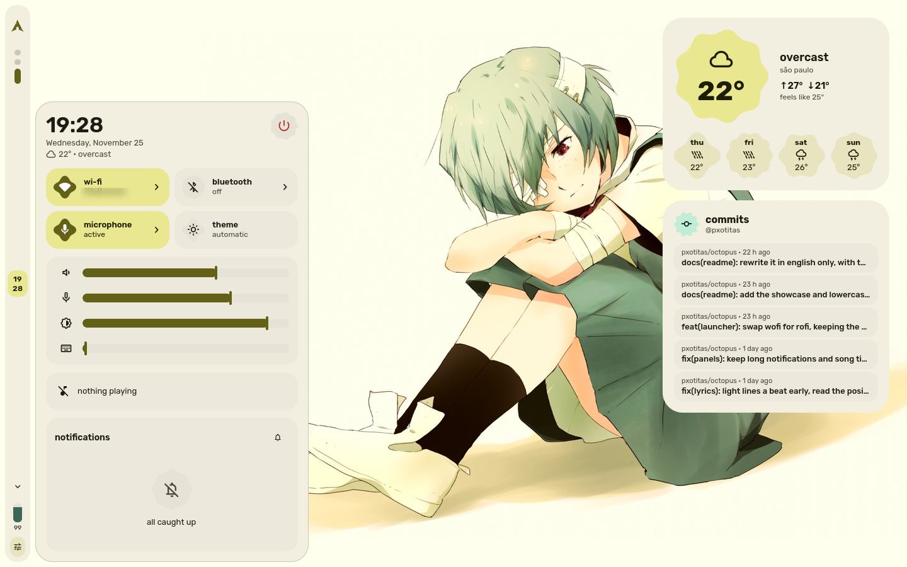

</details>

<details>
<summary><b>dash</b>: rail, clocks, calendar, player, notifications, weather and wallpapers</summary>
<br>

the overview, opened from the clock on the bar: a navigation rail, an analog clock on a cookie, and the notifications over a small weather card.


the wallpapers tab; picking one also makes the palette.

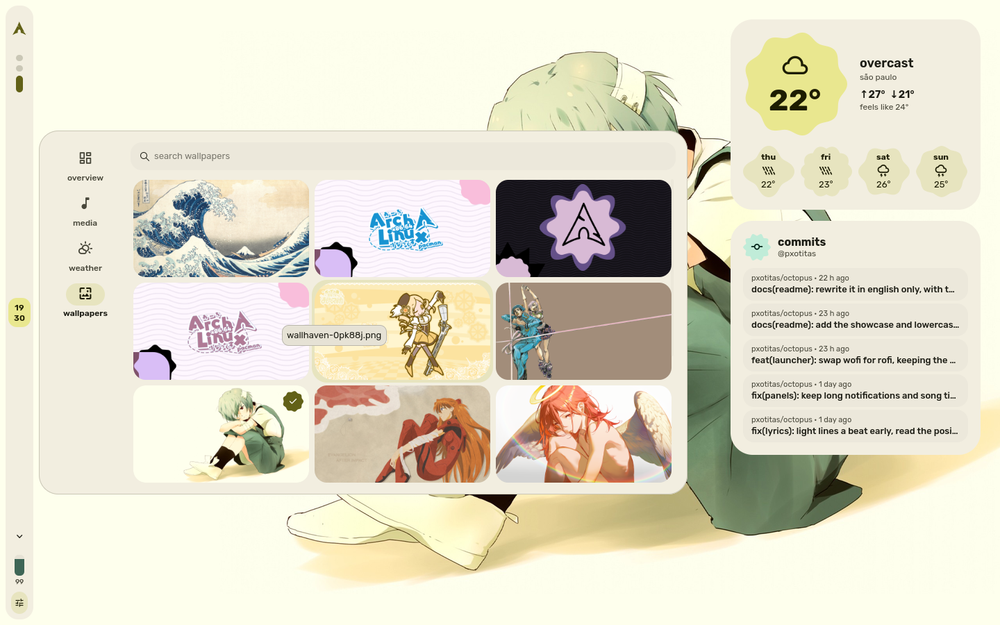

</details>

<details>
<summary><b>weather</b>: m3 shapes, and questions after a <code>&gt;</code></summary>
<br>

right now: metrics in m3 shapes, the sun's arc and the moon, the next 24 hours and the days.

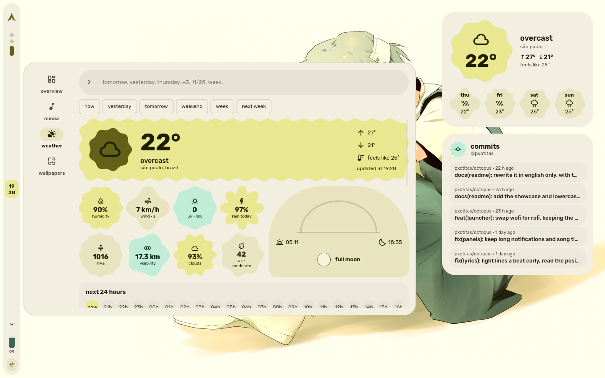

<code>&gt; tomorrow</code>: one day, and how it compares to today.


<code>&gt; yesterday</code>: a week back is there too.


<code>&gt; week</code> and <code>&gt; weekend</code>: days in shapes, with the warmest, the coolest and the rainiest.


</details>

<details>
<summary><b>menus</b>: wi-fi, bluetooth, sound, tray and power</summary>
<br>

wi-fi

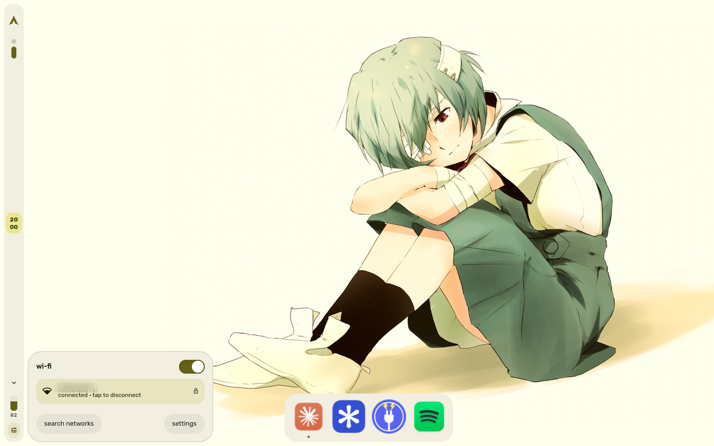

bluetooth


sound, with output, microphone and devices

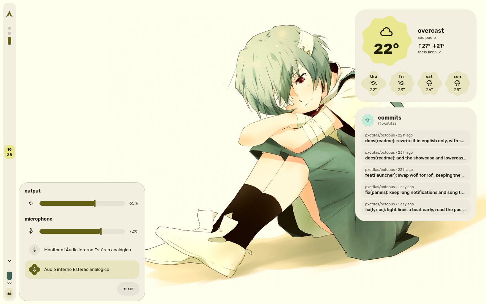

tray


power


</details>

<details>
<summary><b>launchers</b>: the spotlight and rofi</summary>
<br>

the spotlight (mod+space): apps, `=` for math, `/` for files and `>` for power.

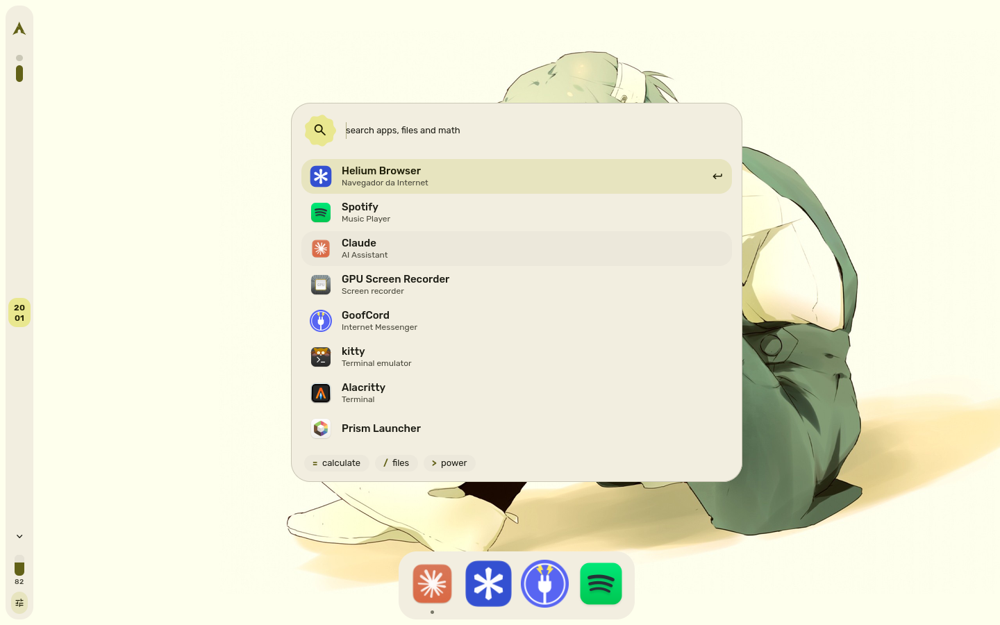

rofi (mod+d), with the apps ranked by use.

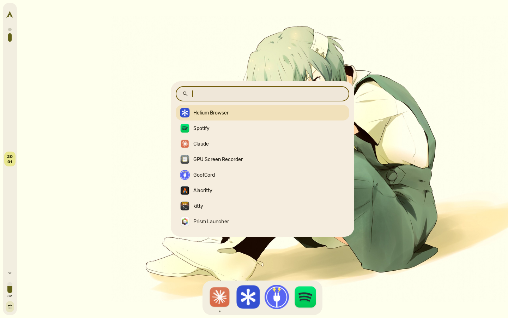

</details>

<details>
<summary><b>tools</b>: clipboard and emoji</summary>
<br>

clipboard (mod+shift+v)

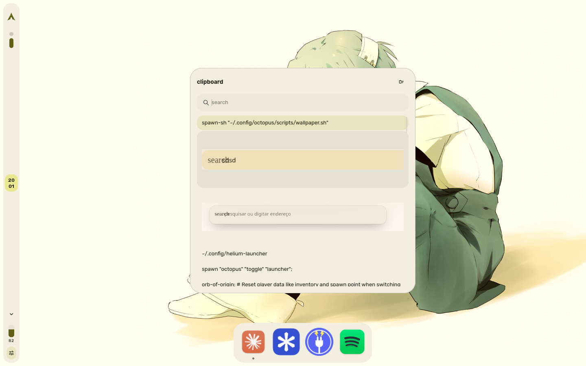

emoji (mod+.)


</details>

<details>
<summary><b>settings</b>: colors, language, bar, widgets and dock</summary>
<br>


</details>

## pieces

| part | what |
|---|---|
| `waybar/` | the vertical bar: logo, workspaces, clock, tray (with the animated arrow from `tray-arrow.c`), a battery pill with its percentage and the group with a drawer |
| `companion/` | `octopus`, the daemon: control center, dash (with a wallpaper picker), spotlight, menus (wi-fi, bluetooth, sound, tray, clipboard, emoji, power), dock, settings, notifications, osd and the lock screen |
| `scripts/` | theme, battery, weather, lyrics, emoji, rofi and matuwall |
| `matugen/` | color templates for the companion, waybar, fuzzel, rofi and matuwall |
| `niri.kdl` | autostart, shortcuts and layer rules, included from niri's config |

more in [`docs/`](docs/README.md).

## install

needs: `pam waybar matugen matuwall awww cliphist wl-clipboard wtype
playerctl cava brightnessctl networkmanager bluez-utils libpulse python
unicode-emoji unicode-cldr fd gcc rofi gtk3 gtk4 gtk4-layer-shell
ttf-material-symbols-variable rust`.

the repo lives in `~/.config/octopus` itself:

```sh
git clone https://github.com/pxotitas/octopus ~/.config/octopus
~/.config/octopus/install.sh
```

the build goes to `~/.cache/octopus/target`.

then, at the end of `~/.config/niri/config.kdl`:

```kdl
include "~/.config/octopus/niri.kdl"
```

## commands

```
octopus                      # the daemon
octopus toggle <control-center|dash|wifi|bluetooth|audio|tray|clipboard|emoji|power|launcher>
octopus open wallpapers      # the dash on its wallpapers tab
octopus settings
octopus close
octopus lock
octopus volume <up|down|mute>
octopus mic mute
octopus brightness <up|down>
octopus kbd <up|down>
octopus dnd
octopus reload               # writes waybar's config again
octopus restart
octopus luma <image>         # dark or light, used by the automatic mode
```

## settings

`octopus.toml` (or `octopus settings`): language, bar, dock, weather,
notifications and lyrics. to override styles without touching the built-in
css, make a `~/.config/octopus/style.css`; it reloads on its own.

## license

gpl-3.0-or-later. some parts come from [impasto](https://github.com/andreumassanet/impasto)
and [velatura](https://github.com/pxdritz1/velatura); see
[`notice.md`](https://github.com/pxotitas/octopus/blob/main/NOTICE.md) on main.
